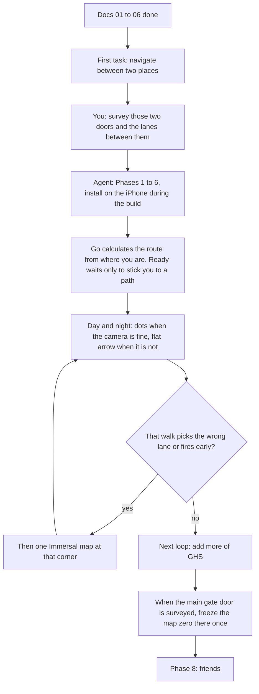

# navigay: Implementation Plan

Doc 6 of 6 · Draft 4 · 24 Nov 2026

End-to-end build order for a working v1 on your iPhone 17. Feature IDs: [PRD](01-PRD.md). Tech: [TRD](02-TRD.md). Screens: [App Flow](03-app-flow.md) and [UI/UX Brief](04-ui-ux-brief.md). Map files: [Map Data Schema](05-map-data-schema.md).

**First task (now):** make navigation work between **two places** in GHS. Survey those two doors, route from where the phone has stuck the user, and walk it with dots or the flat arrow. Then map the rest of GHS in loops. An older chat checklist (Niantic / Scaniverse / Unity `6000.3.14f1` / boys-girls lanes for v1) is obsolete; this doc wins. Unity is **6000.3.29f1**, the same pin as the TRD. Do not upgrade mid-project.

Do the phases in order unless the two-point slice below says otherwise. Do not commit unless asked.

**Who does what**

| Who | Owns |
|---|---|
| **You** | Tools on the Mac and iPhone, GHS walks, geojson.io drawing, door GPS, Immersal photos, Xcode install, test walks with friends |
| **Agent (this chat)** | `tools/build_graph.py`, Unity project and C#, tests, Immersal wiring, logo placement, walk-log tooling, doc updates when you ask |

---

## 0. Where things are on 24 Nov 2026

**Docs:** all six are written. Wireframes live under `UI package/App flow screens`.

**Map (already cleaned in a side chat; leave the cleanup alone):**

| File | What it is |
|---|---|
| `map/ghs.geojson` | Drawing to keep. 34 lanes, 53 junctions, 15 doors, 22 block outlines. IDs are `lane_001`, `junc_001`, `block_001`, `door_001` |
| `map/archive/ghs-before-schema.geojson` | Copy from before the rename |
| `map/id-crosswalk.csv` | Old ID → new ID |
| `map/id-ledger.csv` | Every ID so far |
| `map/places.csv` | B1–B3, B5–B10, G2–G4, Quess Mess, BlueDove Mess, Underpass entrance |
| `map/photo-maps.csv` | Header only |
| `map/build/problems.geojson` | Open drawing problems |

Checked already: no lane crosses a building, and every junction sits on a lane.

**Source geometry for this build:** `data/ghs-current-export.geojson`. It is the latest full-precision export from the live geojson.io map (168 features). `map/ghs.geojson` stays the stable-ID drawing. Do not replace it with the export. `data/ghs.geojson` is an earlier dedupe of the same map (112 features) and is not the source. Routing IDs still come from `map/ghs.geojson`, `map/id-crosswalk.csv`, `map/id-ledger.csv`, and `map/places.csv`.

**Not built yet:** `tools/build_graph.py`, `app/`, `origin.json`. Good. Do not freeze the map zero until the main gate door is surveyed. `start=yes` on the underpass is only the connectivity root.

### Leave these alone until a walk says otherwise

| Thing | Why |
|---|---|
| No outline for B4 or G1 | Not on this drawing. Do not invent one |
| Four outlines named `unknown_block_1` … `unknown_block_4` | Rename only after looking at the building |
| `lane_014` north end | Road toward B11 / B12 / new girls' blocks. Leave the end. No destination on it yet |
| Gaps `lane_015` (~42 m), `lane_021` (~28 m), `lane_023` (~19 m), `lane_025` (~3 m) | Real breaks. The script must not weld them |
| B11, B12, new girls' blocks | Finish the old map first |
| All 15 doors have `needs_survey` | Guessed on the building side nearest a lane. Not real entrances yet. `door_001` (underpass) still needs a GPS average |
| Underpass is the only `start=yes` | Placeholder connectivity root until the main gate exists. Not where a walk starts |
| Boys / girls / staff tags | Stored. v1 code must not filter |

**geojson.io trap.** Import `map/ghs.geojson` before any export. An export from an old browser tab overwrites the cleaned file.

---

## 1. End-to-end flowchart

The picture above is the order. Do not survey the whole campus, freeze the map zero, and only then install the app. The phone install happens in Phases 2–6, on the two-place slice. Immersal comes after that walk, and only if a corner is wrong.

**Done for the first task** means: outdoors at GHS, pick one of the two places, press Go, get a route from the stuck point, follow dots or the flat arrow, arrive, Done. Night leaves Ready without a working camera.

**Done for v1** means the same thing across the mapped campus: pick a place from the list, press Go, follow dots or the flat arrow to the nearest door, arrive, Done back to the list, all offline, $0, Immersal logo on camera screens, underpass ends at the entrance. The map zero is frozen and never moved. That campus is reached by repeating the loop, not by blocking the first walk on it.

---

## 2. Your checklist (everything on your end)

Do these yourself. The agent cannot stand at a door or click Allow on your phone.

### A. Tools (once)

| # | Task | Done when |
|---|---|---|
| A1 | Mac: Unity Hub + **6000.3.29f1** (Unity 6.3 LTS, Apple silicon) with **iOS Build Support** | Editor opens; iOS module listed. Do not install a different 6000.3 patch |
| A2 | Keep TRD §3 and `ProjectSettings/ProjectVersion.txt` on this same number | Both say **6000.3.29f1** |
| A3 | Mac App Store: latest **Xcode** that supports your iPhone 17's iOS | Xcode builds to the phone |
| A4 | Free **Apple ID** signed into Xcode (7-day installs). TestFlight optional / costs money — not required for v1 | Phone trusts the Mac |
| A5 | Free **Immersal** account + Immersal Mapper on the iPhone | You can log in and map |
| A6 | Python 3.12+ (you have 3.14). Agent creates `tools/.venv` | `python3 --version` works |

### B. Map and doors (blocks Phase 3 install of a real graph)

| # | Task | Done when |
|---|---|---|
| B1 | In geojson.io, **import** `map/ghs.geojson` (not an old tab) | Cleaned IDs visible |
| B2 | Drag each draft door to the real entrance | Door sits at the doorway, not mid-façade |
| B3 | Mess: one door per open side; list them in `places.csv` `door_ids` with `;` | Quess / BlueDove match reality |
| B4 | Delete wrong doors; leave ID in `id-ledger.csv` with a `note` | No ghost entrances |
| B5 | Name `unknown_block_*` only if you know the building | Or leave unknown |
| B6 | Add **main gate** place + door; set gate `start=yes`, underpass `start=no` | Gate is the connectivity root |
| B7 | Walk: ~30 s GPS average **twice** at each door, underpass, main gate. Waypoint name = door ID (`door_014`) | GPX / list of waypoints |
| B8 | Give waypoints to the agent (or move doors yourself). Clear `needs_survey` / `draft` only for doors you stood on | Surveyed doors have real coords |
| B9 | Fix real gaps on the walk (`lane_015` etc.) by drawing or accepting them | Gaps intentional or closed |
| B10 | After the main gate door is surveyed: one build **freezes** the map zero in `origin.json` from that door. Commit only when asked. Never move it later. This is not where walks start | `map/origin.json` stable |

### C. Photo maps (only after bad corners show up)

| # | Task | Done when |
|---|---|---|
| C1 | At a junction where layer 1 picks the wrong lane or fires early: photograph with Immersal Mapper (≤100 images) | Map appears in Immersal portal |
| C2 | Download `.bytes`, put in `app/Assets/navigay/PhotoMaps/` | File on disk |
| C3 | Agent aligns and adds `photo-maps.csv` row; you verify on a walk | Match puts you on the right lane |

### D. Install and prove it works

| # | Task | Done when |
|---|---|---|
| D1 | Allow **Location** (Precise on) and **Camera** when the app asks | S4 can start |
| D2 | Each new build: Xcode → iPhone 17. Reinstall every 7 days on free Apple ID | App runs |
| D3 | ~10 routes day and night. Note metres off at each turn | Numbers written down |
| D4 | Friends install from your Mac only if D3 looks sane | They reach doors without help |

---

## 3. Agent checklist (build phases)

### Phase 1 — Graph script on the Mac

`tools/build_graph.py`, `tools/requirements.txt` (shapely 2.x, pytest), `tools/tests/`. Rules: schema §§8–11.

**Done when**

- pytest covers join, split, door attach, and every failure in schema §9 on small fake maps
- Failure names the ID and exits 1; never writes back into `ghs.geojson`
- Ends farther than 2 m stay apart (19 / 28 / 42 m gaps stay gaps)
- v1 connectivity treats every access tag as walkable
- Map-zero trap: while the underpass is still the only `start=yes`, do not commit `origin.json`. A local file from a dry run is not a freeze. After the main gate door is surveyed, one freeze from that door, then never move it. `start=yes` is only the connectivity root

### Phase 2 — Unity project + empty install

Unity **6000.3.29f1**. Immersal can wait until Phase 7. Folders per TRD §11. Player settings per TRD §3. Install this empty build on the phone. Do not wait for the full campus survey.

**Done when**

- Empty scene builds and installs on the iPhone 17 via Xcode
- Portrait, iOS 17+, ARM64, IL2CPP, ARKit required
- Camera / location usage strings match App Flow
- Unity Analytics and Cloud Diagnostics off
- No Google, Apple Maps, Niantic, or ARCore Geospatial packages

### Phase 3 — List from the graph

`GraphLoader` → S2 / S3. No place name or coordinate hard-coded in C#.

**Done when**

- **Where to?** is a search field. With no stuck point, empty groups are omitted and the type groups match `places.csv`. On 24 Nov 2026 those live groups are Blocks, Food, and Gates. B2 comes before B10. When stuck, **Near you** lists places from nearest walking route to farthest, ranked once. Typing filters names. No Boys/Girls control. A two-place slice may show fewer rows
- Missing / bad `graph.json` stops the app (broken build, not a normal screen)
- Real `graph.json` via `build_graph.py --install` only after origin rule is satisfied; until then fixture graphs for editor tests

### Phase 4 — Router

A* in `Routing/` per TRD §7. Edit Mode tests; no phone required.

**Done when** tests show:

- Nearest door of a place wins (mess with two doors)
- A `staff` lane is used when shorter (v1 does not filter)
- Polyline does not pass through a block outline
- Underpass route ends at its door
- No path → clean failure on Ready (`Can't find a way there.`), from the calculation at Go, not from opening the guide

### Phase 5 — Position, snap, Ready

`WhereAmI` + lane snap, layer 1 only. Then S4 Ready.

**Done when**, outdoors on the iPhone 17:

- Walk log records GPS, compass, ARKit pose (no camera images)
- Snap stays on the lane you walk; no snap across a block outline
- Inside a block: `You're inside B3. Step outside to start.` (or unnamed building line)
- Guide starts only once the user is stuck: outside, locked to one lane, reported error about 25 m or better, held about 2 seconds. The camera does not have to be working
- A dark or lost camera still leaves Ready. The guide uses the flat arrow. Dots stay off until the camera is fine
- The route was calculated at Go, before this wait. Ready can already say `Can't find a way there.`
- Precise Location off (accuracy > ~1,000 m) → Settings prompt

### Phase 6 — Guidance and camera UI

Guide, countdown, confidence, dots, checkpoint sign, edge arrow, flat 2D arrow (Hold), turn card, trip bar, End, S6 Arrival. All tunables in `NavConfig`. Layout from UI/UX Brief / App Flow.

**Done when**

- Edit Mode: countdown never rises on a GPS jump; may rise after walking back > ~3 m; checkpoint at ~8 m or passed; confidence drops immediately, rises after 2 s
- One short phone route: dots on lane, turn line, trip numbers, vibration at turn, arrival at door
- Lower, cover, or dark camera → flat **2D** arrow on the guide; words stay. This does not return to Ready. Edge arrow when dots are off-screen in Full/Short
- Opening the guide does not calculate a new route. A new route happens only after the user has left the current one
- Place-card minutes and the opening trip-bar minutes come from the same stuck point. Until then the card says `Step outside to see the time.`
- End on S5 returns to place list (no confirm sheet)
- Underpass arrival includes `This is the entrance. navigay stops here.` when that place is used

### Phase 7 — Immersal logo, then photo maps

Import Immersal SDK **2.5.0**. Put **their** logo on camera screens (S4–S6) before the first photo map exists.

**Done when**

- Screenshots: logo clear of dots and turn card
- App launches; once a map exists, localizes in **airplane mode** with empty developer token. If not, stop and document in TRD — do not add a network call to fake it
- A match slides dots over ~1 s
- `photo-maps.csv` stays header-only until the first real spot (your C1–C3)

### Phase 8 — Measure, then friends

~10 routes day and night against PRD metrics. Worst turns → next photo maps.

**Done when**

- Metres off written next to each route; app still shows no accuracy claim
- Battery for a 10-minute walk recorded
- Zero crashes on those walks
- Optional: friends on 7-day Xcode installs

---

## 4. If you only have a short week

1. Phase 1 tests on fake maps (agent)
2. Phase 4 router tests (agent)
3. Your door walk (you), in parallel
4. Then phone: Phases 2, 3, 5, 6
5. Photo maps last, only at bad corners

A route to a draft door tests code. Do not show friends a draft-door route.

---

## 5. v1 complete checklist

All of these must be true:

- [ ] Map zero in `origin.json` frozen from the main gate door; never moved. Walks still start wherever the user is stuck
- [ ] Every door friends will use is surveyed (no `needs_survey` on those)
- [ ] `build_graph.py` green; `graph.json` installed into the app
- [ ] App installs on iPhone 17; permissions work
- [ ] Place list → Go → Ready → Guide → Arrival → Done → list
- [ ] Re-route after ~20 m off works without asking
- [ ] Night / phone down: flat arrow + text still work
- [ ] Underpass: arrival at entrance only
- [ ] Immersal logo always on camera screens
- [ ] Airplane mode: route + (if any) photo-map match still work
- [ ] ~10 measured walks logged; no crash
- [ ] Running cost $0

---

## 6. Not a step in v1

Android, 2D map, favourites, voice, step counter, depth, accounts, server, database, live `graph.json` download, Boys/Girls/Staff filter (F2), guidance inside the underpass, Google or Apple map data, Niantic, TestFlight (unless you choose to pay). Search is in v1, inside **Where to?**.

F2 in v2 is a router + list filter on tags already in the files. No v1 step reads them.

---

## 7. First task: two places, then the rest of GHS

The first outdoor walk is **Bluespring counter at Quess Mess** (`poi_bluespring_counter`) to **B1 badminton court** (`poi_b1_badminton_court`). Both pins are in `data/ghs-current-export.geojson` exactly once. They mark the destinations. They are not surveyed doors. The walking entrance for each one still has to be checked on foot.

Ignore every other place name until this walk works outdoors. The export still supplies the lane geometry for the route between them.

### What the export contains

168 features: 66 lines, 57 points, 45 polygons. Properties use `kind`, not the stable file's `feature`. After one copy of each repeated ID, 113 IDs remain: 53 junctions, 34 lanes, 23 blocks, 2 POIs, 1 entrance.

| Issue | Count | What to do when deriving the route |
|---|---|---|
| Repeated IDs | 52 IDs, 104 rows | 51 groups are exact copies. Keep one. |
| `lane_osm_1568303900` | 2 geometries | Keep the 5-vertex line with `geometry_note` (the adjusted gap south of the southern block). Drop the 4-vertex copy. |
| Features with no ID and no properties | 3 polygons | Drop them. They are the same shapes as `block_015` `unknown_block_4`, `block_016` `unknown_block_2`, and `block_017` `unknown_block_3`. |
| IDs already in `map/id-crosswalk.csv` | 110 | Use the stable ID (`lane_001`, `junc_001`, `block_001`, `door_001`). Do not mint a second ID. |
| IDs with no stable row | 3 | `poi_bluespring_counter`, `poi_b1_badminton_court`, and `block_osm_1159010179` (Ocean Hills Pool). |

The 14 drafted doors `door_002`–`door_015` have no `old_id`. They stay `needs_survey`. Do not attach either pin to one of them. Bluespring is about 53 m from draft `door_014` (Quess Mess) and about 24 m from `lane_009`. The badminton court is about 69 m from draft `door_002` (B1) and about 20 m from `lane_018`. A door more than 15 m from a lane fails the build, so these pin coordinates cannot be entered as doors. Ocean Hills Pool is new outline geometry. It is not a destination on this walk.

### You do now

| # | Task | Skip for now |
|---|---|---|
| 1 | Confirm Unity is **6000.3.29f1**. Xcode already installed is enough | A different 6000.3 patch. Scaniverse / Niantic. Immersal Mapper only when a corner stays wrong |
| 2 | The two places are fixed: Bluespring counter (`poi_bluespring_counter`, 75.5615731, 26.8409804) and B1 badminton court (`poi_b1_badminton_court`, 75.5628476, 26.8416026) | Choosing a different pair. Full places list, Warden office, Pool, B11, restaurants |
| 3 | On foot, find the walking entrance for each pin. GPS ~30 s **twice** at that doorway. The pin stays the destination name; the averaged point becomes the door | Treating the pin coordinate as the door. Surveying all 15 drafted doors. Moving `door_014` or `door_002` onto these pins without standing there |
| 4 | Lanes for this walk come from the export, reconciled to stable IDs as in the table above. Add only a missing lane if the two doorways are not on the reconciled lanes | Redrawing the campus. Naming Ocean Hills Pool as a place. Closing every gap |
| 5 | If neither place is the main gate, leave the underpass as `start=yes` so the connectivity check has a root, or temporarily mark one of the two places `start=yes`. That flag is not where the user starts walking. Do **not** commit `origin.json`. A local uncommitted map zero may exist so the script can build a test graph. Do not align a photo map to it, and do not rewrite a committed zero later. Freeze once from the main gate door after that door is surveyed | Freezing the map zero from the underpass, or from a door you plan to move |

### Agent does next (when you say go)

1. Phase 1 script on small fake maps. The real-map dry run reads `data/ghs-current-export.geojson`, applies the reconcile table above, and keeps stable IDs from `map/ghs.geojson`. It does not copy the raw export over `map/ghs.geojson`, and it does not freeze `origin.json`.
2. Phases 2–6 on the phone: the list shows these two places once their entrances are real doors. Router, WhereAmI + snap, Ready, Guide, Arrival.
3. You install and walk from wherever you are standing to Bluespring counter or B1 badminton court, by day and at night. Write metres off at each turn. Night must leave Ready onto the flat arrow.
4. Phase 7 photo map **only** if that route picks the wrong lane or fires early.
5. **Then** expand the drawing and `places.csv` to the rest of GHS.

### Done for the two-point slice

- [ ] Bluespring counter and B1 badminton court each have a field-checked entrance. The lanes between those entrances build from the reconciled export without failure
- [ ] App: from wherever you are standing, pick place A or B → Go calculates before Ready waits → dots, or the flat arrow at night → arrive at the other door
- [ ] The place card says `Step outside to see the time.` until the phone is stuck, then matches the guide
- [ ] Metres off at turns written down; no accuracy claim on screen
- [ ] Offline; Immersal logo on camera screens once Immersal is imported

### Obsolete from the old checklist

| Old item | Now |
|---|---|
| Unity `6000.3.14f1` for Niantic | Unity **6000.3.29f1** for Immersal. Do not upgrade mid-project |
| Scaniverse + Niantic token | **Immersal Free** Mapper; no token in the app for on-phone maps |
| Boys / girls / staff lanes for routing | Tags stored; **v1 does not filter** |
| Name every place and draw the whole campus first | **Two points first**; full map later |
| Posters / QR | Never |

## 8. After the two-point slice

Return to §2 B (full door survey, main gate, origin freeze) and §3 Phase 8 (friends). Expand places and lanes without changing the app architecture.
